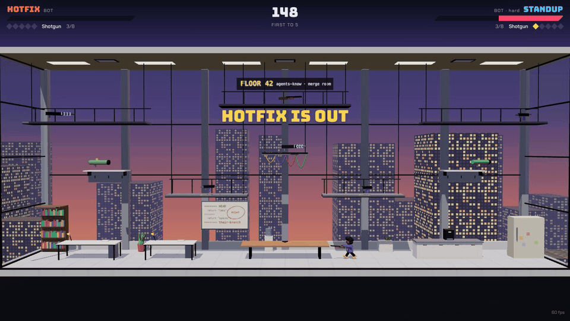
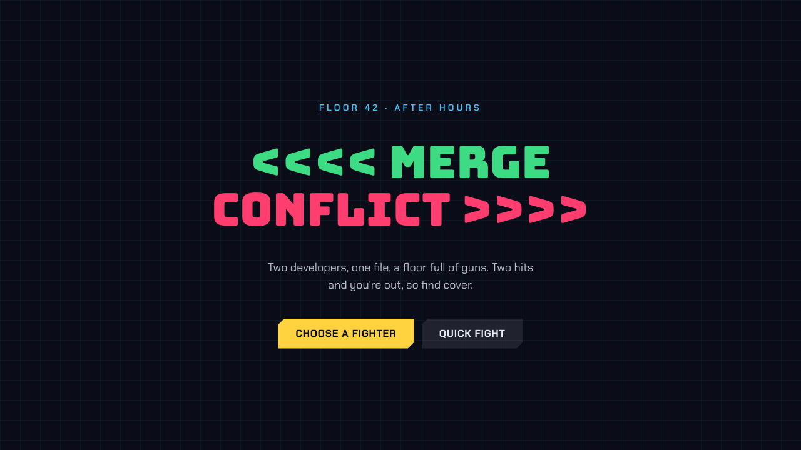
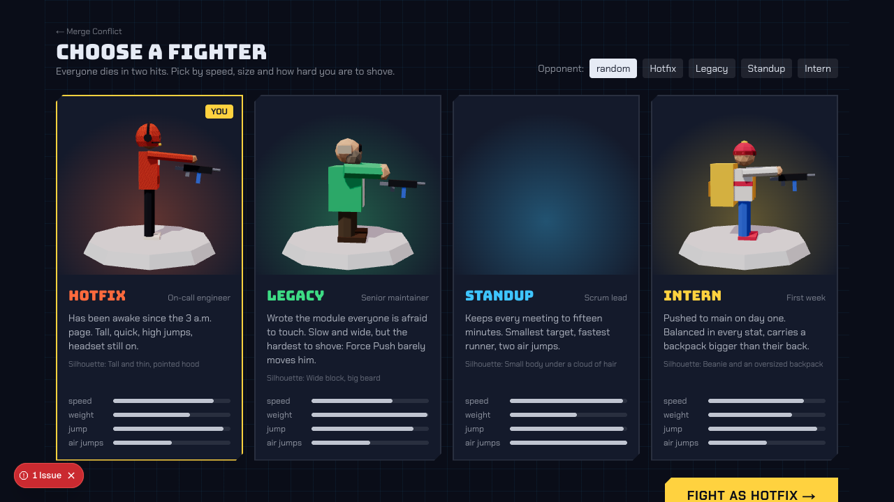

<div align="center">

# Merge Conflict

### Two developers, one file, a floor full of guns. Settle it on floor 42.

**A fast side-on office shootout in the browser. Two hits and you're out.**<br>
Your gun **aims itself**, so the whole game is moving, jumping and timing your shots.
Desks, walkways and cabinets are **cover**. A **Force Push** shoves your rival into the glass and sends their bullets back at them.
A rocket crosses the whole office in a second.



</div>

## What you get

- **Two hits and you're out.** Pistol: two shots. Rocket, railgun, point-blank shotgun: one. Standing still and trading shots loses; cover, jumps and dashes win.
- **Auto-aim by default.** Space shoots, the gun tracks your rival. Prefer aiming yourself? Press **T** for mouse aim (the choice is remembered).
- **Five guns on the floor.** Everyone starts with a pistol that never runs dry. Walk over a gold ring for an SMG, a shotgun, a railgun that goes through furniture and people, or a rocket launcher whose blast throws you too (rocket jumps). More drops from the ceiling vents.
- **Force Push.** A shove on a short cooldown. It knocks your rival back, splats them into the glass walls (the glass cracks) and **reflects incoming bullets** back at the shooter.
- **An office you fight across.** Three levels: desks, a meeting table and a kitchen on the floor, hanging walkways and a cable tray in the middle, a mezzanine under the ceiling. Wall-kick off the glass, double jump, drop through furniture.
- **Four original fighters.** Hotfix (tall, hood up, headset on), Legacy (wide, bearded, hardest to shove), Standup (small, fastest, two air jumps) and Intern (beanie, a backpack bigger than their back).
- **Sound without a single audio file.** Every gunshot, blast and crack is synthesised live with WebAudio.
- **A bot with three levels.** `easy`, `normal`, `hard`: reaction time, aim error and how often it dodges.

<div align="center">


[Play locally](#play-locally) · [Controls](#controls) · [Guns](#guns) · [How it works](#how-it-works) · [Status](#status)

</div>

<table>
  <tr>
    <td></td>
    <td></td>
  </tr>
</table>

## Play locally

```bash
npm install
npm run dev
```

Open http://localhost:3000.

- `/characters`: pick your fighter and an opponent
- `/arena?p1=legacy&p2=standup&bot=hard`: jump straight into a fight
- add `&demo` to watch bot against bot

## Controls

Keyboard only. Your gun aims at the opponent by itself.

| Key | Action |
| --- | --- |
| A / D | move |
| W | jump, again in the air, wall-kick off the glass |
| Space | shoot (hold for automatic fire) |
| S | drop through furniture, fast fall |
| Shift | dash: you can't be hit while it lasts |
| Q | Force Push |
| E | swap for the gun you're standing on |
| T | auto-aim / mouse aim (in mouse mode left click shoots too) |
| M | mute |

Reloading is automatic (R reloads early). Enter starts a rematch.

## Guns

| Gun | What it does |
| --- | --- |
| Pistol | accurate, 8 rounds, never runs out, two hits to KO |
| SMG | fast and loose, three hits to KO |
| Shotgun | six pellets, a one-shot KO up close, kicks you back |
| Railgun | one-shot KO, goes through furniture and through people |
| Rockets | fly straight, one-shot KO near the blast, throw everyone around, you too |

A shot coming down onto or up into furniture is stopped. A shot skimming along a desk top grazes past.

## How it works

```
src/game/sim      pure TypeScript simulation, fixed 60 Hz, deterministic, no DOM
src/game/render   Three.js view: low-poly characters, the office, guns, particles
src/game/sfx.ts   WebAudio sound synthesis
src/components    Next.js pages and the HUD
```

- **The rules don't know about the screen.** `step(state, inputs)` advances the game by one tick. The renderer only reads the state. The same `step` will run on the game server, which will decide every hit, so nobody can cheat from the browser.
- **Fixed timestep, smooth picture.** Logic runs at exactly 60 ticks a second on any monitor. Frames in between are interpolated.
- **Deterministic.** Spread and ceiling drops come from a seeded random number generator stored in the state, so the same inputs always replay the same match. A test checks it.
- **Everything is code.** Characters, guns and the office are built from primitives, animation is procedural, the skyline and the whiteboard are drawn into canvas textures. No model files, no image assets, no audio files.

```bash
npm run test:run    # simulation tests: guns, cover, rockets, Force Push, KOs, bot determinism
npm run type-check
```

## Status

| | |
| --- | --- |
| Single player against a bot, desktop keyboard | ✅ playable |
| Four characters, five guns, one arena | ✅ |
| Two players on one keyboard | next |
| Online rooms (invite by link, quick match) on a Colyseus server | planned |
| Mobile and touch | not planned yet |
