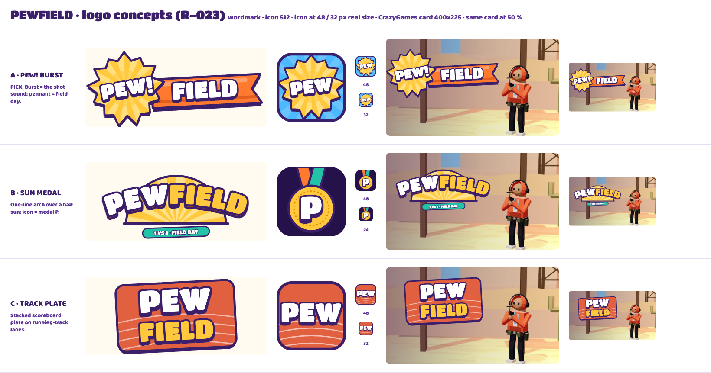

# Brand: PEWFIELD (R-023)

Owner: Creative Director. Name decision and collision checks: `docs/growth/game-name-cd-2026-11-28.md`. Style source: Direction B "Field Day" (`CREATIVE/ui/direction-b/spec.md` §2.2 tokens, §3.1 wordmark slot). Status: concepts done, pick made; Reis confirms the name first.

## 0. Problems first

- **The logos are drawn with live text in the SVGs** (Titan One embedded as a data URI). They render the same everywhere a browser renders SVG, but a design tool without the font support may substitute it. Before shipping, engineering exports the final wordmark and icon with text converted to paths (Inkscape `Path > Object to Path`, or render from the PNGs), and checks the PNG matches.
- **The icon at 32 px is the limit.** "PEW" in the burst reads at 48 px and is mush-but-recognisable at 32. For 16 px favicons use the burst alone with no text (`svg/a-mark.svg` scaled, or a flat sun burst). Rule below.
- **The thumbnail cards here are logo tests, not covers.** They use the current OFFSITE poster and an old-roster fighter. Real CrazyGames covers need the R-022b fighters facing each other (that work is with the roster turn).
- **No player or legal review.** The originality statement below is my check, not a legal one; run `agents-know:ip-guard` on the final files.

## 1. The pick: A · "PEW! burst"

| | A · PEW! burst (**pick**) | B · Sun medal | C · Track plate |
|---|---|---|---|
| Idea | A comic sound burst says "PEW!", then FIELD on a field-day pennant | One-line PEWFIELD arched over a half sun, "1 VS 1 · FIELD DAY" pill; icon = medal with P | PEW over FIELD on a running-track scoreboard plate |
| Small read | icon "PEW" readable at 48 | icon "P" readable at 32, but a "P" in a medal says nothing about the game | best raw legibility at 48 |
| Ownable | the burst is the mark: it can be an icon, a hit stamp, a sticker, the water tower | an arched word over a sun is a common casual-game shape | a plate with words is generic |
| Verdict | **pick**: the only one where the logo *is* the game's sound and gives us a symbol | reject: weakest symbol | reserve: use its stacked layout only if A fails a real small-size test |

Why A: the name's first half is a sound, and comics draw sounds in bursts. So the burst is not decoration: it is the name drawn. It ties to Direction B's sunburst (the burst is filled with sun rays in `--sun` / `--sun-hi`) and gives us one shape for the icon, the favicon, the KO stamp family and the world (water tower, banners).

Files (all in this folder; re-render with `node build.mjs`):
- `svg/a-wordmark.svg` (1200x520), `png/a-wordmark.png`
- `svg/a-icon.svg` (512, sky tile), `png/a-icon-512.png`, `png/a-icon-48.png`
- `svg/a-mark.svg` (512, burst only, transparent)
- `png/a-thumb-400x225.png` (wordmark on a CrazyGames-sized card)
- B and C: same file pattern with `b-` / `c-`. `png/overview.png` shows all three side by side, with the icons at true 48 and 32 px.

## 2. Spec for the pick

- **Burst:** 13 points, inner radius 0.78 of outer, points jittered by up to 7 % (fixed, see `burst()` in `build.mjs`), rotated so one point is straight up. Fill `--sun #FFC83D`, inner rays `--sun-hi #FFE38A` at 85 %, outline `--grape #3B1F6B` at 5.5 % of the radius, grape drop below at 7 % of the radius.
- **PEW!:** Titan One, white, grape outline (stroke 9 % of size, painted under the fill) and grape drop 8 % of size, rotated -7°. In the icon the "!" is dropped.
- **Pennant:** `--tang #FF7A2F` with a swallow-tail on the right, grape outline, a 28 % white gloss stripe on top, a `--tang-lo` line near the bottom. FIELD in Titan One white with grape outline and drop.
- **Whole wordmark:** tilted -3° (matches the §3.1 slot's block tilt).
- **Icon tile:** `--sky #4CB8FF`, radius 112/512, white rays at 16 %, 20 px grape border. Burst fills 92 % of the tile.
- **Sizes:** wordmark never under 160 px wide. Icon with text from 48 px up. Under 48 px (favicon 16/32): burst with no text.
- **Wordmark slot (direction-b §3.1):** the slot shows `a-wordmark` as one image, scaled to fit 420x118 (it is 1200x520, so the fit is height-bound: about 272x118). Boot screen: scale 1.25. The two-word text style in §3.1 is replaced by this image.
- **Don't:** recolour the burst, put a gun in or near it, outline it in black, stretch it, add a drop shadow other than the grape drop, set "PEWFIELD" in any other font.

## 3. Fonts and originality

- Titan One: SIL OFL 1.1, Reserved Font Name "Titan" (`fonts/OFL-TitanOne.txt`). Baloo 2 (used on the overview sheet only): SIL OFL 1.1 (`fonts/OFL-Baloo2.txt`). Copies of the direction-b woff2 files. A logo made with an OFL font is fine; the RFN rule only matters if we modify and ship the font itself.
- Original artwork: every shape is generated by `build.mjs` from our tokens. No logo, icon or lettering was traced or copied. I checked against the logos I know in this space (Brawl Stars, Fall Guys, Stumble Guys, Smash Karts, Shell Shockers, Stick Fight): none uses a sound burst with a pennant, and none of them uses Titan One [from my knowledge of those logos, not a side-by-side check]. Comic sound bursts are a common comics convention, not anyone's trade dress.

## 4. Rename: every place "Floor 42" has to change (one pass)

Rule: the **game** becomes Pewfield. **"FLOOR 42" stays as the office map's name** (`arenaChoice.ts` office name, the sign texture in `render/arena.ts`, code comments about the building). Internal ids and storage keys (`floor42:settings` etc.) stay, so saved settings survive; Fly app `floor42-game` and the server URL stay unless engineering wants to move them.

### Game (engineering, `floor-42/`)
| Where | What |
|---|---|
| `src/app/layout.tsx` 17-21 | title default / template, description, `appleWebApp.title`, `metadataBase` -> `https://pewfield.nalbakigames.com` |
| `public/site.webmanifest` | `name`, `short_name` -> Pewfield; icons from `a-icon` |
| `public/icons/icon-192.png`, `icon-512.png`, `maskable-512.png` | from `svg/a-icon.svg` (maskable: burst inside the 80 % safe circle on the sky tile) |
| `public/favicon.svg`, `favicon.ico`, `favicon-16.png`, `favicon-32.png`, `apple-touch-icon.png` (also in `portal/static/`) | burst mark; 16/32 without text |
| `public/brand/logo.svg`, `logo-light.svg`, `logo-mono.svg`, `emblem.svg` (also `portal/static/brand/`) | replace with `a-wordmark` / `a-mark`; mono = grape one-colour version (engineering may derive: all fills grape, keep white text knock-out) |
| `tools/brand/logo.py` | old logo generator: retire or point at this folder |
| `public/og.jpg` | new OG image: wordmark + two fighters, 1200x630 |
| `src/components/menu/MainMenu.tsx` 105, 677, 944 | logo alt, sr-only h1, HOW TO PLAY kicker |
| `src/components/menu/Credits.tsx` 77, 98 | "Pewfield · version", kicker |
| `src/components/ArenaGame.tsx` 836 | **keep**: it is the office arena's name card (`arenaId === 'office'`) |
| `src/components/OnlineLobby.tsx` 450 | share: `title: 'Pewfield'`, `text: 'Fight me in Pewfield'` |
| `src/components/InstallHint.tsx` 17, 42; `TouchControls.tsx` 321 | player-facing "Floor 42" -> Pewfield |
| `src/game/copy.ts` tagline + intro lines | tagline stays "Two coworkers. One grudge. No mercy."; any line naming the game -> Pewfield |
| Wordmark slot (direction-b b01/b02/b19) | `a-wordmark` image per §2 |
| `src/game/render/arenaOffsite.ts` 458-465 (water tower tank, `fillText('42')`) | paint **PEWFIELD** on the tank in `--sun` with a grape outline, sized to fit the 256 px canvas width with 12 px margins (a town name, like real water towers). Replaces the gold "42" and answers the growth doc's open question. |
| `portal/index.html` 12, 14, 32 | `<title>`, meta description, boot logo src + alt |
| `scripts/portal-zip.mjs` | zip name `pewfield-crazygames.zip` |
| `server/index.ts` 18, `fly.toml` 1 | log line / comment only (optional) |
| `src/vendor/nalbaki-support/core.js` 120 | "quick online duels in Pewfield" (vendored from the site; change at the source too) |
| `README.md`, `ASSETS.md`, `docs/TECHNICAL.md`, `docs/ARENA.md`, `docs/BALANCE.md`, `docs/portal/README.md` | title, tagline ("Code review got personal..." is developer copy, remove), links |
| `docs/demo.gif`, `docs/home.png`, `docs/characters.png` | re-capture after the new UI ships |
| `docs/portal/covers/*` (6 files) and `docs/portal/screens/` | new covers with the wordmark and R-022b fighters, 1920x1080 / 800x1200 / 800x800 |

### Studio site (`nalbaki-games/`)
`games/floor-42.html` (rename to `games/pewfield.html`, 301 the old path in `vercel.json`), `index.html`, `games.html`, `about.html`, `contact.html`, `press.html`, `support.html`, `privacy.html`, `services.html`, `work.html`, `playables.html`, `404.html`, `games/hazefall.html`, `games/parking-lot.html` (cross-links), `site.js`, `vendor/nalbaki-support/core.js`, `sitemap.xml`, `README.md`, `assets/brand/games/floor-42/` (new logo + emblem; new folder `pewfield/`), `assets/playables/floor-42.html`, `docs/growth/*` (growth agent updates its own plan).

### Outside the repos (Reis / growth)
- DNS: `pewfield.nalbakigames.com` (+ `pew-field` redirect), 301 from `floor42.nalbakigames.com/*`.
- CrazyGames listing: title, description, covers, the uploaded zip. Not submitted yet, so this is free now.
- Videos and trailers (game-video-lead): any clip with the old logo or "Floor 42" title card.
- Any itch.io page or social profile that uses the old name; the itch account name in `lib/links.ts` is Reis's call.
